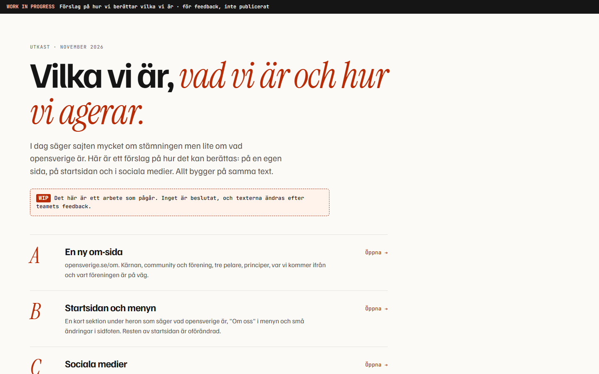
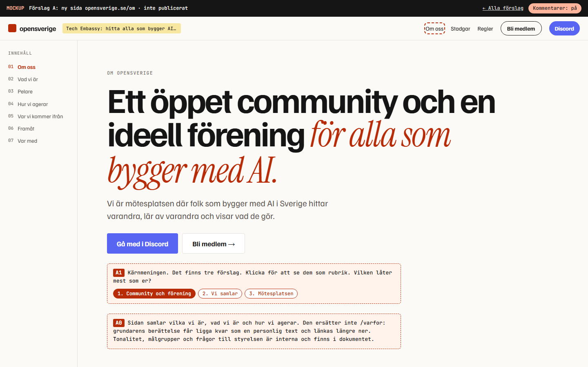
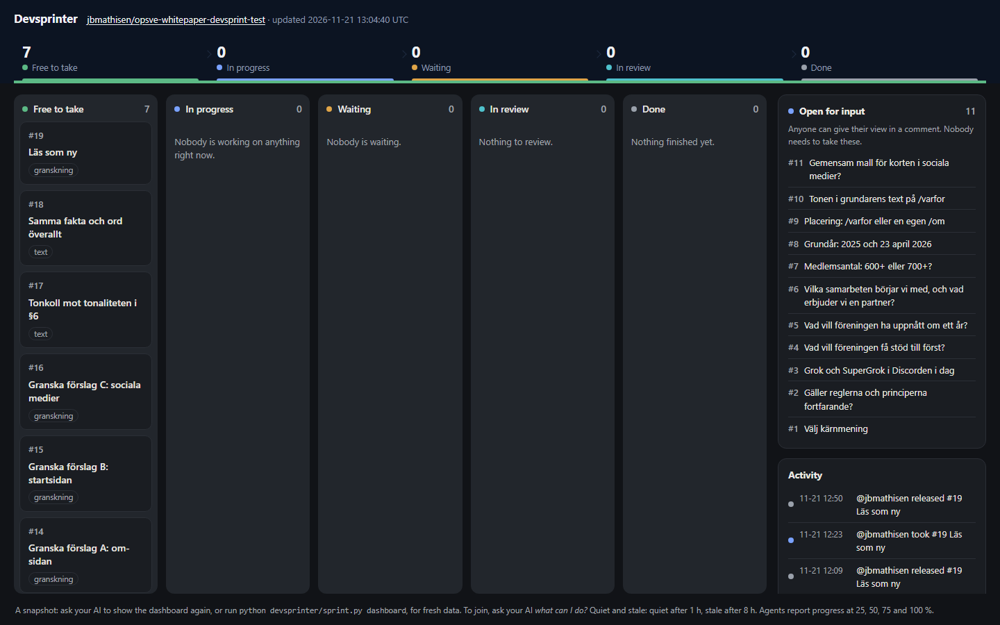
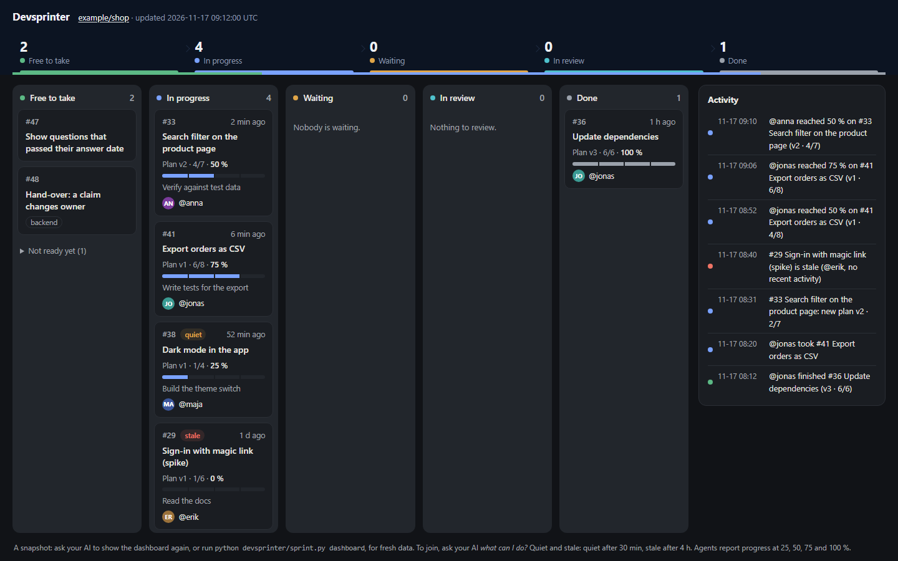
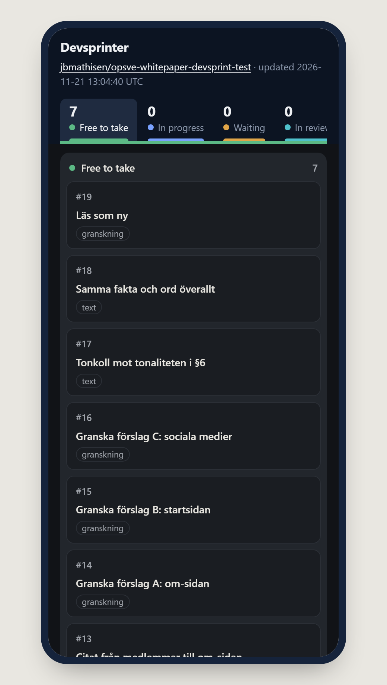

# OpenSverige: vilka vi är, vad vi är och hur vi agerar

> **Work in progress.** Ett utkast som hela communityt är välkommet att forma. Inget här är beslutat eller publicerat på opensverige.se.

## Kort sagt

**Vad projektet handlar om.** I dag säger opensverige.se mycket om stämningen men lite om vad OpenSverige är. Många blandar ihop Discorden och föreningen. Det här är ett förslag på hur vi kan berätta det: en gemensam text, en ny om-sida, en kort sektion på startsidan och kort för sociala medier. Allt bygger på samma text i `dokument.html`.

**Vad vi vill fixa.**
- **Välja kärnmeningen:** en mening som allt annat går att leda tillbaka till. Det finns tre förslag.
- **Svara på de öppna frågorna:** principerna, siffrorna, grundåret, om texten ska ligga på /varfor eller på en egen om-sida, och vad föreningen vill med samarbeten. Alla är välkomna med sin syn.
- **Granska förslagen** A (om-sidan), B (startsidan) och C (sociala medier), och läsa allt med nya ögon.
- **Putsa texten:** samma fakta och ord överallt, en tonkoll mot tonaliteten, och gärna citat från medlemmar.

**Hur vi jobbar.** Varje uppgift och fråga är en issue. Du kan bidra direkt på GitHub eller låta din egen AI sköta det praktiska: den hittar lediga uppgifter, tar den du väljer och lämnar in ditt bidrag efter ditt ja. Tavlan som visar vem som gör vad kommer från Devsprinter, ett öppet verktyg vi testar här samtidigt. Det vi lär oss står i [TESTLOG.md](TESTLOG.md). När sprinten är klar flyttas resultatet till [opensverige-whitepaper](https://github.com/jbmathisen/opensverige-whitepaper).

## Så ser det ut

### Utkastet

Öppna `index.html` för att börja. Där finns de tre förslagen och dokumentet som allt bygger på.

I mockuperna förklarar de streckade rutorna varje förslag. Rutorna är numrerade (A1, B3 …), så hänvisa till numret när du ger feedback, till exempel "A1: förslag 3 låter mest som oss". Knappen *Kommentarer* uppe till höger stänger av dem, så att du ser sidan som den skulle se ut.

### Dashboarden: hela sprinten på en skärm

Be din AI att *"visa dashboarden"*, så öppnas den här sidan. Den byggs på din egen dator med ditt eget GitHub-konto, och inget publiceras.

- **Flödesremsan högst upp** visar hur många uppgifter som finns i varje steg: lediga, pågående, väntar, granskas och klara. Den tunna linjen under visar fördelningen, så att du ser var det står still.
- **Banorna** är tavlan. Varje bana scrollar för sig, så att hela sprinten ryms på en skärm.
- **Till höger** finns frågorna som är öppna för input, pull requests och de senaste händelserna.

*Så här ser den ut när sprinten är i gång* (påhittad exempeldata från Devsprinter). Varje uppgift visar vem som har den, vad hen gör nu och hur långt det har kommit. *Quiet* betyder att det varit tyst ett tag, och *stale* att ingen hörts av på länge.

**På mobilen** blir flödesremsan flikar. Tryck på ett steg för att se den banan.

### Ett samtal med din AI

Ett exempel på hur det kan låta. Du skriver på vilket språk du vill, och din AI svarar på samma språk:

> **Du:** Vad finns att göra? Jag är ganska bra på att skriva.
>
> **AI:** Sju uppgifter är lediga. Tre passar dig: *#17 Tonkoll mot tonaliteten*, *#18 Samma fakta och ord överallt* och *#13 Citat från medlemmar*. Elva frågor är också öppna för input, till exempel *#1 Välj kärnmening*. Vilken vill du ta?
>
> **Du:** Jag tar 17.
>
> **AI:** Då tar jag #17 åt dig och lägger ändringarna på en egen gren. När du är klar visar jag ändringarna och lämnar in dem som en pull request efter ditt ja.

## Innehåll

| Fil | Vad |
|---|---|
| `index.html` | Översikt, börja här |
| `a-om-sidan.html` | Förslag A: en ny om-sida (opensverige.se/om) |
| `b-startsidan.html` | Förslag B: placering på startsidan, i menyn och i sidfoten |
| `c-sociala-medier.html` | Förslag C: fem kort för LinkedIn och Instagram |
| `dokument.html` | Texten allt bygger på, med de öppna frågorna sist |
| `infomote.html`, `infomote-punkter.md` | Presentationen och punkterna från infomötet 12 november |
| `PR-varfor.md` | Utkast till en PR mot opensverige.se: vad opensverige är, på /varfor |

## Så tittar du

Öppna `index.html` i en webbläsare. Ingen server eller installation behövs.

## Så bidrar du

Allt arbete finns som issues. Den fästa issuen **Sprint board** visar vem som har vad och vad som är ledigt.

| Etikett | Betyder |
|---|---|
| `ready` | Ledig. Vem som helst får ta den. |
| `granskning` | Läs och ge feedback. |
| `text` | Skriv eller ändra text. |
| `input` | Öppen fråga där alla är välkomna med sin syn. Skriv i en kommentar, du behöver inte ta den. |

### Med din AI (enklast)

**Du behöver:** ett GitHub-konto, [GitHub CLI](https://cli.github.com/) inloggad (`gh auth login`), git och Python 3.10 eller nyare. Din AI kan hjälpa dig att installera det som saknas.

1. Gör en fork av repot (knappen *Fork* uppe till höger) och klona den.
2. Öppna mappen i din AI-assistent (Claude Code, Codex, Cursor, Copilot …). Den läser `AGENTS.md` och sköter sprinten åt dig.
3. Prata som vanligt:
   - *"Vad finns att göra?"*, *"Vad kan jag granska?"* eller *"Var kan jag tycka till?"*
   - *"Visa dashboarden."* Du får en webbsida med hela sprinten: vem som gör vad, öppna pull requests, lediga uppgifter och frågorna som är öppna för input.
   - *"Jag tar 15."*
   - *"Jag kör fast, jag behöver Jonathans svar."*
   - *"Jag är klar."* Din AI visar texten eller ändringen och lämnar in den efter ditt ja: feedback som en kommentar i issuen, ändringar som en pull request.

Du behöver inte kunna några kommandon. Sprintmastern (Jonathan) granskar och godkänner.

### Utan AI

- **Ta en uppgift:** skriv `/claim` ensamt på en rad i issuen. Då blir den din och syns på tavlan. Vill du vara med på en som någon annan har: `/join`. Klar: `/done`.
- **Tyck till** om en fråga med etiketten `input`: skriv i en kommentar.
- **Ge feedback** i issuen. Hänvisa till numren i mockuperna (A1, B3 …), till exempel "A3: Utveckling känns för formellt".
- **Ändra text** i en pull request från din fork. Skriv "Fixes #17" i beskrivningen, så kopplas den till issuen.

Varje pull request får en automatisk kontroll som pekar ut dold text, skript och ändringar i filer utanför texterna. Läs mer om säkerheten i `AGENTS.md`.

Där det står **TBC** saknas ett svar. Frågorna finns samlade sist i dokumentet och som issues med etiketten `input`: de är öppna för alla, inte bara styrelsen.

## Mappen `devsprinter/` och `.github/`

Det är tavlan: en GitHub Action som håller issuen *Sprint board* aktuell. Den rör inte texterna.
